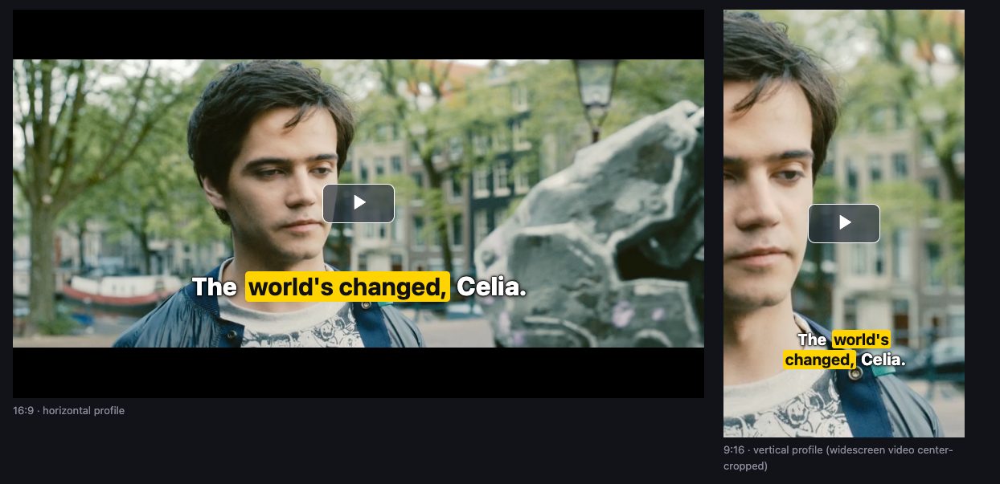

<h1 align="center">Overtone</h1>

<p align="center">
  <strong>Captions cut for every screen shape, from one file.</strong>
</p>

<p align="center">
  <a href="https://github.com/lonthq/overtone-captions/actions/workflows/ci.yml"></a>
  <a href="https://www.npmjs.com/package/overtone-captions"></a>
  <a href="LICENSE"></a>
  
</p>

<p align="center">
  <a href="https://overtone.lont.ai/"><strong>Live demo</strong></a> ·
  <a href="#quick-start">Quick start</a> ·
  <a href="packages/cli/README.md">CLI</a> ·
  <a href="docs/player.md">Player</a> ·
  <a href="docs/format/spec.md">Format spec</a> ·
  <a href="bench/RESULTS.md">Benchmark</a>
</p>

<p align="center">
  
  <br>
  <sub>One <code>.overtone.json</code> file in a 16:9 and a 9:16 player (<code>social</code> style pack), on the
  Blender open movie Tears of Steel.<br>
  Film: (CC) Blender Foundation | <a href="https://mango.blender.org/">mango.blender.org</a>, <a href="https://creativecommons.org/licenses/by/3.0/">CC BY 3.0</a>.</sub>
</p>

Overtone stores each spoken word once, with its time and speaker, and cuts captions separately for each picture
shape: 16:9 and 9:16 by default, or any aspect you name. A CLI makes the file from your subtitles, audio or video. A
video.js plugin shows the cut that fits the player.

## Quick start

Re-cut subtitles you already have. Offline, no API key, no ffmpeg (Node.js 22.12 or newer):

```bash
curl -O https://download.blender.org/demo/movies/ToS/subtitles/TOS-en.srt
npx overtone-captions recut TOS-en.srt
```

You get `TOS-en.overtone.json`, `.horizontal` and `.vertical` `.vtt` and `.srt` files, and a transcript. Word
times are estimated from the cues.

Caption a video from its audio. This needs `ffmpeg` and provider API keys (OpenAI and Azure AI Speech by default;
`overtone providers` lists the variables). `--dry-run` shows where the audio goes and the estimated cost, and sends
nothing:

```bash
npm install -g overtone-captions
overtone transcribe talk.mp4 --language en --context "Panel about urban cycling" --dry-run
overtone transcribe talk.mp4 --language en --context "Panel about urban cycling"
```

`--local` runs offline instead, with whisper.cpp and Ollama.

Show the captions in video.js:

```js
import videojs from 'video.js';
import 'video.js/dist/video-js.css';
import 'videojs-overtone';
import 'videojs-overtone/themes/base.css';
import 'videojs-overtone/themes/clean.css';

videojs('my-video').overtone({ src: 'talk.overtone.json' });
```

## Why

Most captions are cut once, for one screen, by filling each line to a length limit. The 16:9 cut is too wide for a
9:16 phone video, lines end on "the" or "of", and two speakers share a caption.

Overtone keeps a cut per screen shape in one file. The cuts follow reading rules: lines avoid ending on weak words,
names and numbers stay together, each speaker gets their own caption, and pauses become line or caption breaks, so
viewers who cannot hear a hesitation can read it.

The same words and times from a NASA interview, cut for 9:16 (22 characters × 2 lines):

<table>
<tr><th>Filled to the length limit</th><th>Overtone</th></tr>
<tr><td><pre>
the 2004 class. Jim,
thank you for joining

us. It's great to be
here, Allard. Thanks.
</pre></td><td><pre>
Jim, thank you
for joining us.

It's great to be here,
Allard. Thanks.
</pre></td></tr>
<tr><td><pre>
through you? Okay. A
little about me: I

grew up in Eugene,
Oregon. I joined the
</pre></td><td><pre>
Okay.
A little about me:

I grew up
in Eugene, Oregon.

I joined
the Astronaut Corps
</pre></td></tr>
</table>

Why a new format instead of WebVTT or TTML: those store finished cues, so a player can only rewrap them.
`.overtone.json` stores each word once, plus any number of cuts that point to those words. Export WebVTT or SRT per
cut when you need a standard file.

Why not WhisperX, stable-ts or a hosted speech API: they give good words and times, often cheaper. Overtone adds
the caption layout on top. `overtone recut` re-cuts their SRT or WebVTT output, so you can keep your engine.

## How it works

- **Hearings.** Several engines hear the audio. The text hearing (`gpt-transcribe`) gives the words; the timing
  hearing (Azure AI Speech) gives word times and speakers. With `ELEVENLABS_API_KEY` set, ElevenLabs Scribe adds a
  second hearing.
- **Text vote.** Where the hearings disagree, the text model re-listens to the snippet and an LLM chooser picks the
  words.
- **Editor.** An LLM corrects misheard words, names and terms using your context, your glossary and its own world
  knowledge (it fixes "Telecom Cell" to "Telkomsel" without being told), labels speakers and marks key words. Edits
  it is unsure about go on a review list for you to check by ear.
- **Line cuts.** A versioned rule set cuts the lines for each profile. Same words and rule set, same captions.

The LLM never sets timestamps: each word takes its time from the engines. Code checks only the structure of the
LLM's changes. [How the pipeline works](docs/cli/pipeline.md) has every step.

## Packages

| Package | What it is |
|---|---|
| [`overtone-captions`](packages/cli) | The `overtone` CLI: `transcribe`, `recut`, `burn`, `export`, `validate`, `init`, `languages`, `providers`. |
| [`videojs-overtone`](packages/videojs) | The video.js 8.5+ plugin and five style packs: `clean`, `social`, `minimal`, `high-contrast`, `lumora`. |
| [`overtone-format`](packages/format) | The `.overtone.json` format: types, JSON Schema, validator, and WebVTT, SRT and text exporters. No runtime dependencies. |

See every style pack in the [style gallery](https://overtone.lont.ai/styles/).

## Benchmark

Small and public. Method, full tables and caveats: [bench/RESULTS.md](bench/RESULTS.md) and
[bench/captions/RESULTS.md](bench/captions/RESULTS.md).

- **Line breaks** (three English clips, 20.8 minutes, 16:9, rule set 1): 0.3% of Overtone's breaks end on a word
  like "the", "of" or "and" with no pause after it. Filling lines to the limit does that at 28.8% of its breaks,
  ElevenLabs' SRT export at 16.1%. Overtone shows all 47 of the speakers' 0.5–1.5 s pauses as a break; the other
  two show 28% and 72%.
- **Text** (six clips in four languages, 20 minutes, 3 runs, 2026-10-23): on the 5 clips where every engine
  returned text, word error rate 5.3%, against 6.2% for gpt-transcribe alone and 7.7% for Azure Speech alone.
- **Silent failures:** gpt-transcribe returned nothing for a quiet meeting in every run. Overtone retried with the
  language the other engines heard and scored 32.8%, against 42.9% for Azure Speech alone.
- **Cost:** $0.023–0.025 per audio minute in those runs, $0.029 with ElevenLabs Scribe (list prices).

## Limits

- Full line-cutting and number rules exist for English and Dutch. German, French, Spanish, Italian and Portuguese
  have language detection; other languages get neutral rules. See [Language](docs/cli/languages.md).
- In scripts without spaces (Chinese, Japanese, Thai), a "word" is a whole phrase: one time per phrase, and line
  breaks only between phrases.
- No translation, no sound tags such as `[music]`, no GUI editor. Media up to 2 hours.

## Documentation

- [CLI guide](packages/cli/README.md) and [CLI reference](docs/cli/reference.md): every command, option and output
  file.
- [Player guide](docs/player.md): options, style packs and theming.
- [Format specification](docs/format/spec.md).
- [Agent Skill](skills/overtone/SKILL.md) for Claude Code and Codex: copy `skills/overtone` into `.claude/skills/`.
- [Contributing](CONTRIBUTING.md): language packs, style packs and providers. AI coding agents start with
  [AGENTS.md](AGENTS.md).

## License

MIT, see [LICENSE](LICENSE). Made by [Lont](https://lont.ai).
