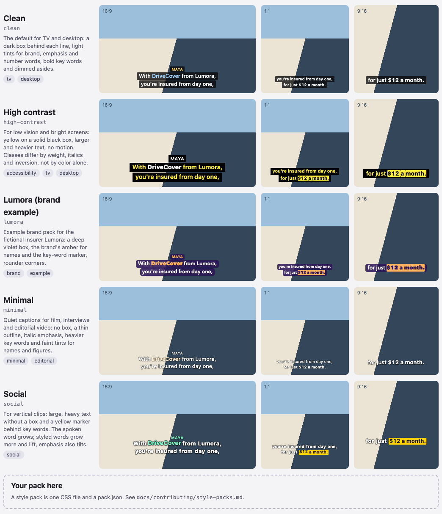

# Make a style pack

A style pack is a caption theme for the Overtone video.js player: one CSS file and a short `pack.json`, no
JavaScript. Make one for a channel, a brand, a kind of video, or viewers who need easier-to-read captions. You copy a
template, design it in a live workbench, and the tests tell you when it is ready:
[step by step](#make-a-pack-step-by-step).



AI agents: follow [style-packs.agents.md](style-packs.agents.md).

## What a style pack is

Each pack is a folder in [`packages/videojs/styles/`](../../packages/videojs/styles/):

```text
packages/videojs/styles/
├── pack.schema.json       the schema every pack.json follows
├── _template/             copy this to start
└── clean/
    ├── style.css          the look: CSS variables, plus optional rules
    ├── pack.json          name, title, description, author, tags, contrast notes
    └── preview.png        generated by npm run styles:previews
```

The build copies every pack to `dist/themes/<name>.css` and lists it in `dist/themes/packs.json`. The
[style gallery](../../examples/styles/) and the demo's theme menu read that list, so a new pack shows up in both
without code changes. Sites load it like a built-in theme:

```js
import 'videojs-overtone/themes/base.css';
import 'videojs-overtone/themes/minimal.css';

player.overtone({ src: '/captions/clip.overtone.json', theme: 'minimal' });
```

`overtone burn --style <name|path>` draws the same markup with the same CSS, so a pack also sets the look of
burned-in video. That is why it must be [self-contained](#the-rules).

Your pack styles this markup, scoped to `.ot-theme-<name>`:

```html
<div class="ot-picture">
  <div class="ot-layer ot-theme-minimal ot-mode-styled ot-profile-horizontal">
    <div class="ot-cue">
      <div class="ot-speaker">Maya</div>
      <div class="ot-line">
        <span class="ot-word" style="--ot-turn: 1"><span class="ot-text">With</span></span>
        <span class="ot-word ot-brand ot-active" style="--ot-turn: -1"><span class="ot-text">DriveCover</span></span>
      </div>
    </div>
  </div>
</div>
```

| Class | Meaning |
|---|---|
| `ot-picture` | The visible video picture. The size container: `cqw` and `--ot-bottom` are relative to it. |
| `ot-layer` | The caption layer. Carries the mode, profile and theme classes. |
| `ot-mode-styled`, `ot-mode-plain`, `ot-mode-off` | The viewer's choice (CC button or <kbd>C</kbd>) |
| `ot-profile-<id>` | The line cut in use, such as `ot-profile-horizontal` (16:9, 42 characters per line) or `ot-profile-vertical` (9:16, 22) |
| `ot-tall` | The profile's aspect is below 1 |
| `ot-cue`, `ot-line` | One caption and its lines. Each line has its own box. |
| `ot-speaker` | Speaker name, when the site turns names on |
| `ot-word` | One word, with its semantic classes |
| `ot-text` | The word's text inside `ot-word`, without the space a joined word keeps after it. Animate it to move the text while the box stays put. |
| `ot-active` | The word being spoken |
| `data-joined` | On a key word followed by another key word, so one marker can run across both |

## The semantic classes

Overtone marks words by meaning. Your pack decides the look.

| Class | Marks | Design for | In the built-in packs |
|---|---|---|---|
| `key` | The few words that carry the message | The strongest signal: weight, a marker or inversion | Bold (Clean), yellow marker (Social), inverted (High contrast) |
| `brand` | Company, product and service names | Recognizable; the place for a brand color | Light blue (Clean), amber and extra bold (Lumora) |
| `emphasis` | A word the speaker stresses | A lift, not a shout: italics or a light tint | Light yellow (Clean), italic (Minimal, High contrast) |
| `number` | Prices, dates, amounts, figures | Easy to scan. Give them a color: tabular digits alone look like plain text. | Mint (Clean), cyan (High contrast) |
| `soft` | Asides and filler ("by the way") | Dimmed, still readable | Dimmed white; gray in High contrast |

A word can have several classes (`$12` is `number` and `key`). When they compete, the later one wins in this order:
`number`, `emphasis`, `brand`, `key`, `soft`. Classes show only in styled mode.

## The variables

Most packs only set variables, on `.ot-layer.ot-theme-<name>`, with tall-layout values on
`.ot-layer.ot-theme-<name>.ot-tall`. Anything you leave out keeps its default from
[`base.css`](../../packages/videojs/src/themes/base.css). Every variable and default: [player guide](../player.md#theming);
all of them as comments: the [template](../../packages/videojs/styles/_template/style.css).

The ones that need care:

- `--ot-font-size` (default `3.4cqw`) is the size of a 42-character line, in `cqw` (1% of the picture width).
  Shorter lines scale up from it. `--ot-scale` (default `1`) is your own factor on top, for example on `.ot-tall` for
  heavy or wide fonts. Font size × scale stays at 3.4cqw or more in every layout.
- `--ot-turn` is `1` or `-1` per word, set by the player. Multiply a tilt by it so words lean both ways:
  `rotate(calc(2deg * var(--ot-turn)))`. Read it; never set it.
- `--ot-pop-scale` scales the spoken word, for packs with a pop rule ([Going beyond variables](#going-beyond-variables)).

For a value of your own, such as an underline color, declare `--ot-pack-<something>` on the layer and use it in your
rules.

## The rules

Captions are read in a second, often on a phone, over video you do not control. `npm run test:styles` checks every
rule below and says what to fix.

**Legible on any video.** Every text color reaches 4.5:1 (WCAG AA) against what is directly behind it:

- With a box, `--ot-bg` is at least 60% opaque. The test measures the box over a white and a black frame and keeps
  the worse result.
- Without a box, the text needs an outline: `--ot-shadow` with at least two centered opaque layers, such as
  `0 0 0.06em #000, 0 0 0.06em #000`, plus a soft drop shadow for bright video. The test measures against the outline.
- Key words with a marker are measured against the marker (`--ot-key-color` on `--ot-key-highlight`).
- `soft` text and speaker names count too.
- Write colors as hex, `rgb()` or `hsl()`. Text and background colors in your own rules come from the variables.

**Plain mode stays plain.** Style the semantic classes and `.ot-active` only under `.ot-mode-styled`.

**Every class stands out.** In styled mode each of the five classes looks different from plain text.

**Reduced motion.** Every `transition`, `animation` or transform on the spoken word has an override inside
`@media (prefers-reduced-motion: reduce)` with the same selector, set to `none`.

**Phone sizes.** Text is in `cqw` and never smaller than the default. Each line fits on one row: the preview script
renders every line at 16:9 (480px wide), 1:1 (360px) and 9:16 (270px) and reports any that wrap.
Heavy text may need a lower `--ot-scale` on `.ot-tall` (Social uses 0.95, High contrast 0.92).

**Every layout is checked.** Contrast runs for wide and tall, for each `.ot-profile-<id>` your pack targets, and for
each `@media` block that sets variables. Size runs for wide, tall and each targeted profile.

**Stay in your scope.** Every selector contains `.ot-theme-<name>` and styles the layer or what is in it, never its
siblings, the control bar or the page.

**Self-contained.** No `@import`, `url()`, `@font-face`, `!important`, `position: fixed` or `z-index`. Allowed
at-rules: `@media`, `@supports`, `@container` and `@keyframes ot-<name>-…`. Never hide or replace caption text
(`display: none`, `visibility: hidden`, `opacity`, `content` with text).

**Fonts.** A pack names fonts and never loads them; a site that wants a web font loads it itself. End with system
fonts and a generic family: `'Avenir Next', 'Segoe UI', system-ui, sans-serif`. Check that the pack looks right with
the fallback alone.

## Make a pack, step by step

You need Node 22.12 or later and a clone of the repository (`npm install` once). The example pack is `newsroom`.

1. Copy the template, then replace every `my-pack` with `newsroom` in both files:

   ```bash
   cp -R packages/videojs/styles/_template packages/videojs/styles/newsroom
   ```

2. Start the workbench:

   ```bash
   npm run styles:dev
   ```

   Open http://localhost:5173/examples/styles/?pack=newsroom. It shows each class at 16:9 and 9:16, styled and plain,
   on a scene with a bright and a dark half, plays one cue word by word (the `spoken` row), and checks that every line
   fits. It rebuilds on save and prints rule problems in the terminal; reload to see a change. A real player:
   http://localhost:5173/examples/demo/?theme=newsroom.

3. Design in `style.css`: the box or outline and the text color first, then the five classes, then tall layouts.

4. Fill in `pack.json`: title, a one- or two-sentence description, your name, tags (`tv`, `desktop`, `social`,
   `brand`, `accessibility`, `minimal`, `editorial`, `example`) and contrast notes. Your editor autocompletes the
   fields from `pack.schema.json`.

5. Run the checks:

   ```bash
   npm run test:styles
   ```

   Each rule is its own test, and a failure says what to change:
   `soft (--ot-soft-color) #9a9a9a on #404040 is 3.30:1 in the wide layout; needs 4.5:1`. Put the lowest ratio in
   your contrast notes.

6. Make the preview (needs Chrome, or `CHROME_PATH`):

   ```bash
   npm run styles:previews -- newsroom
   ```

7. Open a pull request with the folder, a gallery screenshot, and what the pack is for.

For your own site only, skip the pull request: load your CSS after `base.css` and pass `theme: 'newsroom'`.

## Going beyond variables

Add rules below the variables, scoped to your pack. A pop on spoken styled words, simplified from Social (words need
`display: inline-block` to scale):

```css
.ot-theme-social .ot-word {
  display: inline-block;
  margin: 0 0.06em;
  transition: transform 0.12s ease-out;
}

.ot-theme-social.ot-mode-styled .ot-active:is(.ot-emphasis, .ot-key, .ot-brand, .ot-number) {
  transform: translateY(-0.06em) scale(var(--ot-pop-scale));
}

@media (prefers-reduced-motion: reduce) {
  .ot-theme-social .ot-word {
    transition: none;
  }

  .ot-theme-social.ot-mode-styled .ot-active:is(.ot-emphasis, .ot-key, .ot-brand, .ot-number) {
    transform: none;
  }
}
```

An underline for emphasis, with a pack-private color:

```css
.ot-layer.ot-theme-newsroom {
  --ot-pack-underline: #ffcf5c;
}

.ot-theme-newsroom.ot-mode-styled .ot-emphasis {
  text-decoration: underline 0.06em var(--ot-pack-underline);
  text-underline-offset: 0.15em;
}
```

Inline-block words split a key-word marker into separate boxes. Social joins them into one strip with
`[data-joined]`: no gap between boxes, square inner corners, and a still marker while only the spoken word's
`.ot-text` moves. Moving a whole box would open a seam or cover the next word.

## What makes a great pack

- A clear purpose, stated in the description: "captions for cooking videos on a bright countertop".
- Readable first. Squint at the bright half of the gallery scene; if words blur, add weight, a box or a stronger
  outline.
- Few strong key words, everything else quieter.
- Classes that differ by more than color: weight, italics, a marker or inversion.
- Every shape: check 9:16 and 1:1 as carefully as 16:9.
- Small motion, if any.

## Review checklist

- [ ] `npm run test:styles` and `npm test` pass.
- [ ] The folder is named like `pack.json`'s `name` and holds only `style.css`, `pack.json` and `preview.png`.
- [ ] The description says what the pack is for; the tags fit.
- [ ] The contrast notes match the lowest ratio from the tests.
- [ ] In the gallery: every class shows in styled mode, plain mode is plain, no line wraps.
- [ ] It reads well on the bright and dark halves at 16:9, 1:1 and 9:16.
- [ ] With reduced motion on, nothing moves.
- [ ] It looks right with only the fallback fonts.
- [ ] `preview.png` is regenerated and under 100 KB.
- [ ] It adds a look or a use the other packs do not cover.
