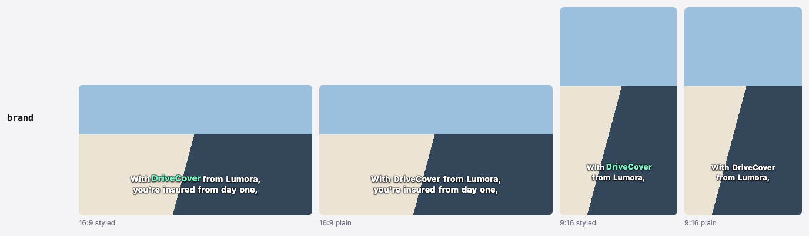

# Player guide: `videojs-overtone`

The video.js plugin plays an `.overtone.json` file over your video. It picks the line cut that fits the visible
picture, styles key words, brands and numbers with a style pack, and gives viewers a plain mode. Short version:
[package README](../packages/videojs/README.md). File format: [format specification](format/spec.md).

<p align="center">
  
  <br>
  <sub>The same words, styled and plain, cut for 16:9 and for 9:16 (from the style gallery).</sub>
</p>

## With a bundler

```bash
npm install video.js videojs-overtone
```

`video.js` 8.5 or newer is a peer dependency. `overtone-format` comes with the plugin.

```js
import videojs from 'video.js';
import 'video.js/dist/video-js.css';
import 'videojs-overtone';                          // registers the 'overtone' plugin
import 'videojs-overtone/themes/base.css';
import 'videojs-overtone/themes/clean.css';
import 'videojs-overtone/themes/social.css';       // load every pack you switch to

const player = videojs('my-video');
const captions = player.overtone({
  src: 'clip.overtone.json',
  theme: 'clean',
  speakers: 'change',
  fallbackTracks: { horizontal: 'clip.horizontal.vtt', vertical: 'clip.vertical.vtt' },
});
captions.setTheme('social');      // switch theme later
captions.cycle();                 // same as clicking the captions button
```

In TypeScript, `import 'videojs-overtone'` types `player.overtone(options)`: it returns an `OvertoneController`
without a cast.

## With script tags

Load `video.js` before `videojs-overtone/dist/index.global.js`. The bundle uses the page's global `videojs` (and
throws "load video.js before index.global.js" without it) and exposes `window.OvertoneVideojs`.

```html
<link rel="stylesheet" href="https://cdn.jsdelivr.net/npm/video.js@8.24.2/dist/video-js.min.css">
<link rel="stylesheet" href="https://cdn.jsdelivr.net/npm/videojs-overtone@0.1.0/dist/themes/base.css">
<link rel="stylesheet" href="https://cdn.jsdelivr.net/npm/videojs-overtone@0.1.0/dist/themes/clean.css">

<video id="my-video" class="video-js" controls src="clip.mp4"></video>

<script src="https://cdn.jsdelivr.net/npm/video.js@8.24.2/dist/video.min.js"></script>
<script src="https://cdn.jsdelivr.net/npm/videojs-overtone@0.1.0/dist/index.global.js"></script>
<script>
  videojs('my-video').overtone({ src: 'clip.overtone.json' });
</script>
```

[examples/cdn/index.html](../examples/cdn/index.html) is this page, complete, on a NASA interview: save it and open
it in a browser. [examples/demo/index.html](../examples/demo/index.html) is the two-player demo.

## Options

| Option | Default | Meaning |
|---|---|---|
| `src` / `data` | none | URL of the `.overtone.json` file, or the document itself. One is required. On a public site, serve the player document (`overtone export clip.overtone.json --export player`), which leaves out the authoring data. |
| `profile` | `'auto'` | `'auto'` picks the profile whose aspect is closest to the visible picture. A profile id forces that profile when the document has it; otherwise `'auto'` applies. |
| `theme` | `'clean'` | Style pack name, see [Style packs](#style-packs). An empty name keeps the default. |
| `speakers` | `'never'` | Speaker names: `'never'`, `'change'` (when the speaker changes) or `'always'` (every cue) |
| `fallbackTracks` | `{}` | Profile id → `.vtt` URL, for iOS native fullscreen |
| `storageKey` | `'overtone-caption-mode'` | `localStorage` key that remembers the caption mode |
| `defaultMode` | `'styled'` | `'off'`, `'styled'` or `'plain'`, used until the viewer picks one. An invalid value keeps the default. |

## Controller

`player.overtone(options)` returns an `OvertoneController`. Calling it again on the same player replaces the
previous one.

| Member | What it does |
|---|---|
| `ready` | Promise that resolves once the document is loaded and set up, and also when loading failed |
| `error` | The load or validation error, or `undefined` |
| `getMode()`, `setMode(mode)` | Read or set the caption mode (`'off'`, `'styled'`, `'plain'`). `setMode` stores it and shows a short "Captions: …" notice. |
| `cycle()` | off → styled → plain → off, like the captions button |
| `setTheme(name)` | Switch the style pack |
| `getProfileId()` | Id of the profile in use, or `undefined` before the document is loaded |
| `dispose()` | Remove the overlay, the button and all listeners. Runs by itself when the player is disposed. |

The plugin never throws on a bad document. It logs the error, sets `error`, shows no captions and hides its button.
video.js's own captions button returns, so the page's `<track>` captions stay available.

```js
await captions.ready;
if (captions.error) console.warn('no Overtone captions:', captions.error.message);
```

**Mode change event.** The player fires `overtone:modechange` with the new mode in `event.mode`. `setMode()` fires
it only on a real change, so syncing two players does not loop
([examples/demo/demo.js](../examples/demo/demo.js)):

```js
player.on('overtone:modechange', (event) => {
  for (const other of controllers) if (other !== controller) other.setMode(event.mode);
});
```

**Without video.js.** `videojs-overtone/core` exports the rendering helpers: `cueIndexAt`, `cueIndexWithHold`,
`CUE_HOLD_SECONDS`, `applyProfileToLayer`, `classToken`, `pictureRect`, `chooseProfile`, `renderCue`,
`shouldShowSpeaker`, `turnOf`, `updateActiveWords`, `wordsOf` and `isInWindow`, as used by `overtone burn` and the
style gallery.

## Behavior

- **Captions button**: replaces video.js's captions and subtitles menu. Each click cycles off → styled → plain → off.
  The <kbd>C</kbd> key does the same while the player has focus (Shift+C too; ignored with Ctrl, Alt or Cmd, while
  typing in a form field, and on key repeat). The choice is stored under `storageKey` when storage is available.
- **Page tracks**: once the document loads, the plugin turns off any showing captions or subtitles track (a
  `<track default>`, or one turned on earlier) and keeps it off, so it does not double the overlay. In iOS native
  fullscreen a track the viewer picks from the native menu stays on. A failed load leaves the tracks alone. A manual
  `dispose()` restores their previous mode and puts video.js's captions button back; disposing the player restores
  nothing.
- **Profile choice**: with `profile: 'auto'` the player uses the profile whose `aspect` is closest to the visible
  picture, comparing ratios on a log scale. A tie goes to the wider profile. Until the video's size is known, the
  player's own shape counts. It checks again on resize, fullscreen, `loadedmetadata` and the video's `resize` event.
- **Visible picture**: the letterboxed video inside the player. With `object-fit: cover` or `fill` it is the player
  box; with `none` or `scale-down`, the video at its own size where that is smaller, cut to the player.
- **Placement**: captions sit over the visible picture. `.ot-picture` wraps `.ot-layer` and is the CSS size
  container, so `cqw` units and `--ot-bottom` are relative to the picture.
- **iOS native fullscreen**: the overlay cannot render there, so the plugin shows the active profile's
  `fallbackTracks` VTT as a native text track (plain text). It adds them only where the browser uses native text
  tracks (Safari, iOS); elsewhere they are never fetched. VTT files on another origin need CORS headers and a
  `crossorigin` attribute on the `<video>`. Tested by hand on an iPhone, not yet on an iPad.

## Style packs

<p align="center">
  
</p>

A style pack is a `style.css` plus a `pack.json` in [`packages/videojs/styles/<name>/`](../packages/videojs/styles),
shipped as `videojs-overtone/themes/<name>.css`. Load `base.css`, then each pack you use; pick one with
`theme: '<name>'` or `setTheme()`.

| Pack | For |
|---|---|
| `clean` (default) | TV and desktop: a dark box, light tints for brand, emphasis and number words, bold key words |
| `social` | Vertical clips: large heavy text without a box, a yellow marker behind key words, a spoken word that grows |
| `high-contrast` | Low vision and bright screens: yellow on a solid black box, larger text, no motion; classes differ by weight and inversion, not color alone |
| `minimal` | Film, interviews and editorial video: no box, a thin outline, italic emphasis |
| `lumora` | Example brand pack for a fictional insurer: a violet box and the brand's amber |

Tests check every pack for contrast (WCAG), plain mode, reduced motion and scoping. To make one:
[Make a style pack](contributing/style-packs.md).

## Theming

The player renders this markup:

```html
<div class="ot-picture">
  <div class="ot-layer ot-theme-clean ot-mode-styled ot-profile-horizontal">
    <div class="ot-cue" data-speaker="S1" lang="en">  <!-- lang: the document's language, left out for "und" -->
      <div class="ot-speaker">Maya</div>              <!-- only with speakers: 'change' or 'always' -->
      <div class="ot-line" dir="auto">                <!-- each line follows its text's direction -->
        <span class="ot-word" style="--ot-turn: 1"><span class="ot-text">With</span></span>
        <span class="ot-word ot-brand" style="--ot-turn: -1"><span class="ot-text">DriveCover</span></span>
      </div>
    </div>
  </div>
</div>
```

`base.css` does the layout and turns CSS variables into styling. A theme mostly sets variables on
`.ot-layer.ot-theme-<name>` and may use `:lang()` and `[dir]` selectors. A brand theme can be this small (load it
after `base.css`, then pass `theme: 'acme'`):

```css
.ot-layer.ot-theme-acme {
  --ot-font: 'Inter', system-ui, sans-serif;
  --ot-bg: rgb(20 24 60 / 0.85);
  --ot-brand-color: #ffb35c;
  --ot-key-highlight: #ffb35c;
  --ot-key-color: #14183c;
}
```

Variables you leave out keep their `base.css` default. Fuller example:
[lumora/style.css](../packages/videojs/styles/lumora/style.css).

| Variable | Default | Used for |
|---|---|---|
| `--ot-font`, `--ot-font-weight`, `--ot-line-height` | system UI font, 500, 1.25 | caption text |
| `--ot-font-size` | `3.4cqw` | size of a 42-character line, in `cqw` (% of the picture width); shorter lines scale up from it. Keep it at 3.4cqw or more. |
| `--ot-scale` | `1` | a pack's own factor, such as `.ot-layer.ot-theme-<name>.ot-tall { --ot-scale: 1.1 }` for tall layouts; font size × scale stays at 3.4cqw or more |
| `--ot-color`, `--ot-bg`, `--ot-radius`, `--ot-padding`, `--ot-shadow` | white on 72% black, `0.2em`, `0.08em 0.4em`, none | text and the box behind each line (`--ot-shadow` is a `text-shadow` for themes without a box) |
| `--ot-bottom` | `6%` | distance from the bottom of the picture |
| `--ot-controls-offset` | `30px` | extra lift while the video.js control bar is visible |
| `--ot-speaker-color`, `--ot-speaker-size` | amber, `0.7em` | speaker names |
| `--ot-emphasis-color`, `--ot-emphasis-style` | text color, normal | `emphasis` words |
| `--ot-key-weight`, `--ot-key-color`, `--ot-key-highlight` | 700, text color, transparent | `key` words |
| `--ot-brand-color`, `--ot-brand-weight` | text color, text weight | `brand` words |
| `--ot-number-color`, `--ot-number-variant` | text color, `tabular-nums` | `number` words |
| `--ot-soft-color` | 72% white | `soft` words |
| `--ot-pop-scale` | `1` | scale of a styled word while it is spoken (only `social` applies it) |
| `--ot-turn` | set per word | `1` or `-1`, the side a word leans to; set by the renderer, read it, do not set it |

- **Styled and plain**: class styling applies in styled mode only. Plain mode keeps the theme's font, colors and box.
- **Sizing**: the text size is `--ot-font-size` × 42 ÷ `--ot-chars` × `--ot-scale`. The player sets `--ot-chars` to
  the profile's `maxCharsPerLine` and adds `ot-tall` when its aspect is below 1, so a full line spans the same share
  of the picture width in every profile, from a small embed to fullscreen.
- **Spoken word**: while a word is spoken, its `.ot-word` gets the class `ot-active`. Only `social` uses it, in styled
  mode. Its motion comes from these variables, with values in
  [`social/style.css`](../packages/videojs/styles/social/style.css):

  | Variable | Used for |
  |---|---|
  | `--ot-pack-grow` | scale of a plain spoken word |
  | `--ot-pop-scale` | scale of a spoken `key`, `brand`, `number` or `emphasis` word |
  | `--ot-pack-lift` | how far those styled words rise (a negative length moves them up) |
  | `--ot-pack-tilt` | rotation of a spoken `emphasis` word, to the side of its `--ot-turn` |
  | `--ot-pack-strip-grow` | scale of the spoken word's text inside a joined key-word strip |

  Tune them after the theme, for example `.ot-layer.ot-theme-social { --ot-pack-tilt: 0deg; }` turns the tilt off.
  Keep scales small: larger words can touch their neighbors. With `prefers-reduced-motion: reduce` nothing moves. In
  your own theme, `--ot-pop-scale` does nothing without a rule like social's, on words with
  `display: inline-block`.
- **Taller control bars**: raise `--ot-controls-offset`, for example
  `.ot-host .ot-layer { --ot-controls-offset: 48px; }`.
- **Class names**: theme names become classes with every character outside `[A-Za-z0-9_-]` turned into `-`
  (`brand.v2` → `.ot-theme-brand-v2`). Profile ids already use only those characters. Target one profile with
  `.ot-profile-<id>`.
